# ServiceNow IT Service Management

A portfolio-ready **ServiceNow scoped application** for managing IT support requests from submission through resolution and closure.

## 📌 Project Overview

This project demonstrates how ServiceNow can be used to build an end-to-end IT Service Management workflow.

Employees can create IT requests for:

* Hardware
* Software
* Network
* Access
* Email
* Other IT issues

The application automatically routes requests to the appropriate support group and manages the request lifecycle from **New → Assigned → In Progress → Resolved → Closed**.

---

## 🏗️ Solution Architecture

```text
Employee
   ↓
IT Request Form
   ↓
Client Scripts
   ├── Requested By Auto-fill
   └── Dynamic Subcategory
   ↓
GlideAjax
   ↓
ITRequestUtils Script Include
   ↓
Assignment Group
   ↓
Business Rule
   ↓
Flow Designer
   ↓
Assigned State
   ↓
IT Support Investigation
   ↓
Resolve Request
   ↓
Resolved Notification
   ↓
Close Request
   ↓
Closed
```

---

## ⚙️ Key Features

### IT Request Management

* Auto-generated request numbers
* Requested By auto-population
* Category and subcategory management
* Priority management
* Request state lifecycle
* Assignment Group
* Assigned To
* Resolution Notes
* Affected Asset reference

### Dynamic Form Behavior

* Automatically populates the logged-in user
* Dynamically changes available subcategories based on Category
* Automatically clears invalid subcategory values when Category changes

### Automated Assignment

Requests are routed according to category:

| Category | Assignment Group |
| -------- | ---------------- |
| Hardware | Hardware Support |
| Software | Software Support |
| Network  | Network Support  |
| Access   | IT Security      |
| Email    | Email Support    |
| Other    | IT Support       |

### Server-Side Logic

The application uses:

* Business Rules
* Script Includes
* GlideAjax
* Flow Designer

The `ITRequestUtils` Script Include provides reusable server-side assignment logic that can be called asynchronously from the client.

### Request Lifecycle

```text
New
 ↓
Assigned
 ↓
In Progress
 ↓
Resolved
 ↓
Closed
```

The application includes dedicated **Resolve Request** and **Close Request** UI Actions.

### Security

Record-level ACLs control access to IT Requests:

* Read → `user`
* Create → `user`
* Write → `user`
* Delete → `admin`

### Notifications

When an IT Request is resolved, the application generates a notification containing:

* Request number
* Short description
* Resolution notes
* Requested By

### Automated Testing

The project includes an **Automated Test Framework (ATF)** test that verifies:

1. An IT Request is successfully created.
2. A request with an Assignment Group automatically moves from **New** to **Assigned**.

---

## 🧩 ServiceNow Components Demonstrated

| Component          | Purpose                                |
| ------------------ | -------------------------------------- |
| Scoped Application | Application organization and isolation |
| Custom Tables      | IT Request and IT Asset management     |
| Client Scripts     | Client-side form automation            |
| UI Policy          | Conditional mandatory fields           |
| Business Rule      | Server-side assignment logic           |
| Script Include     | Reusable server-side logic             |
| GlideAjax          | Client-to-server communication         |
| UI Actions         | Request lifecycle actions              |
| ACLs               | Access control                         |
| Notifications      | Request resolution communication       |
| Flow Designer      | Workflow automation                    |
| ATF                | Automated testing                      |

---

## 📸 Screenshots

### Application & Data Model

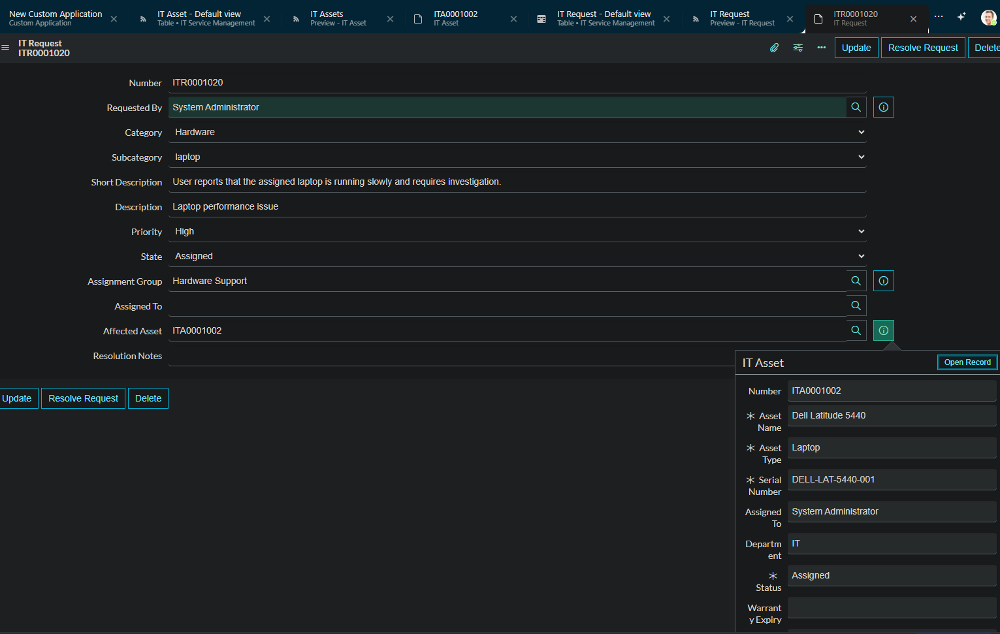

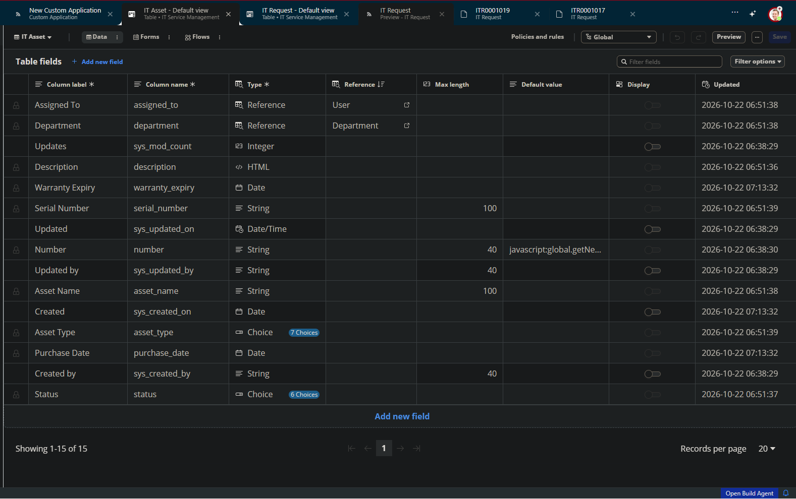

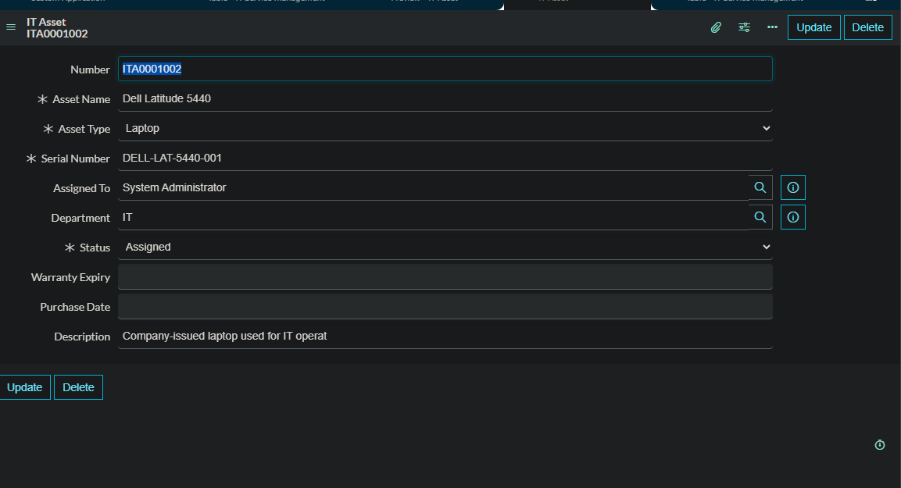

### Client-Side Automation

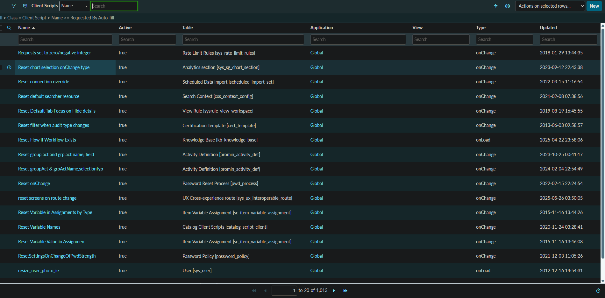

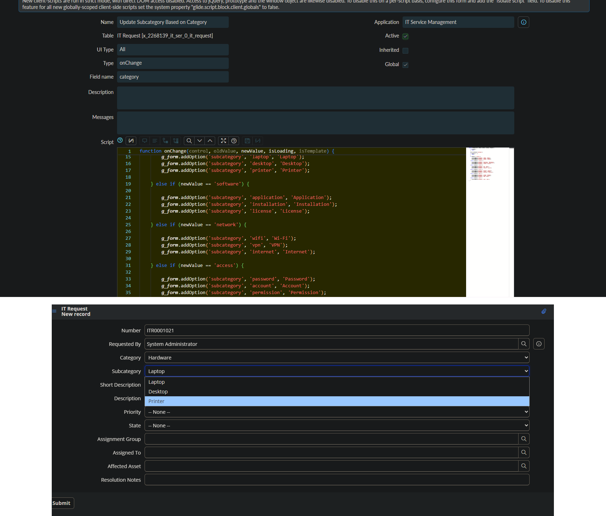

### Server-Side Automation

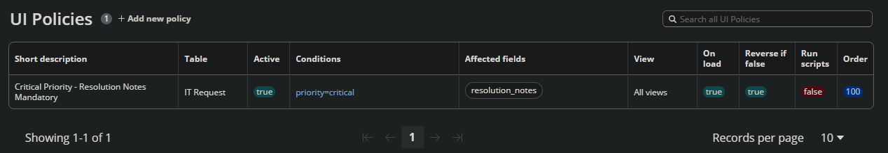

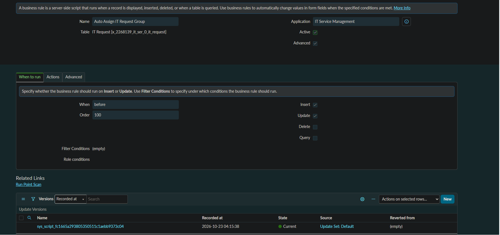

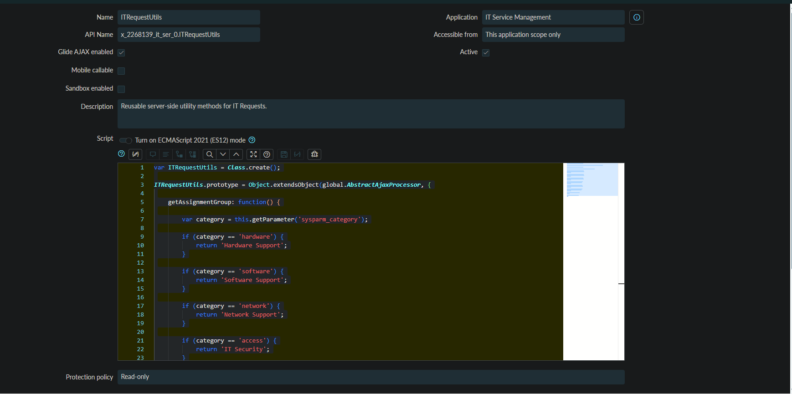

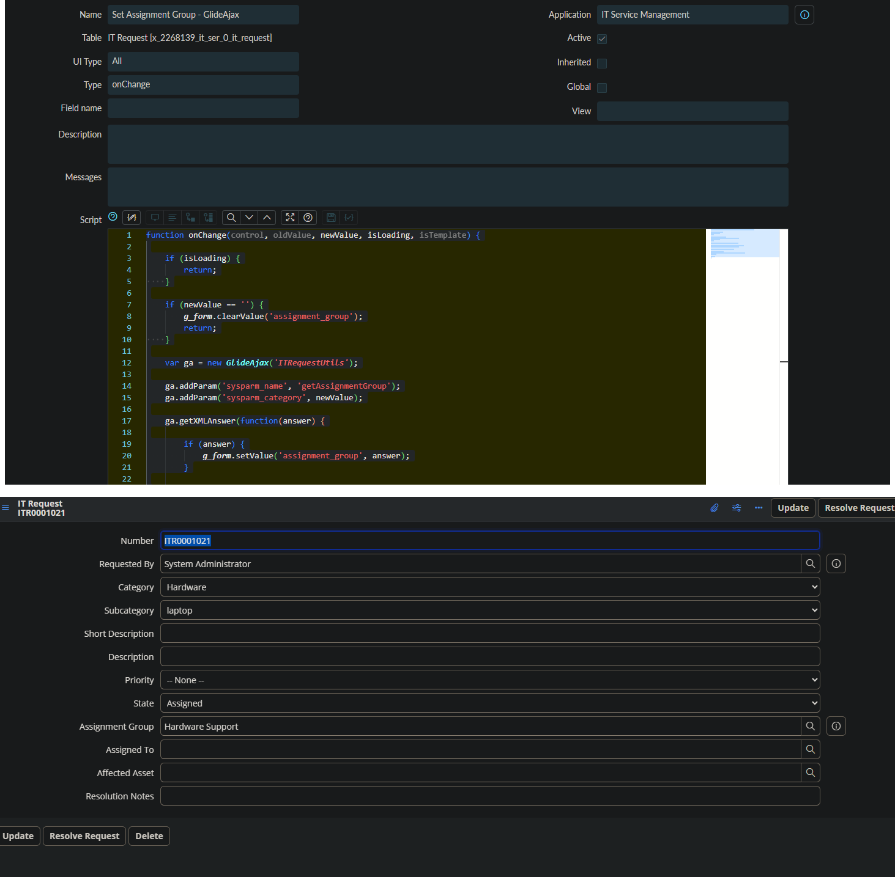

### Request Lifecycle

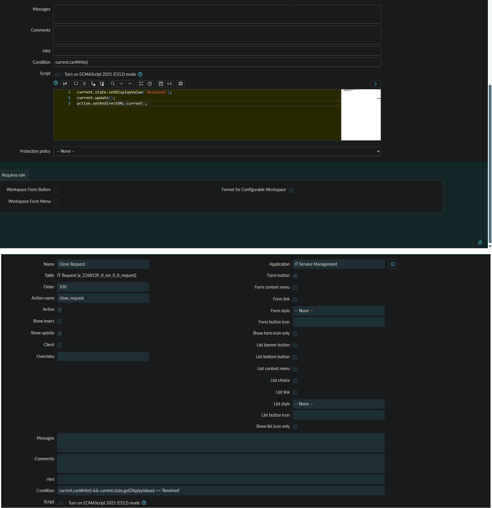

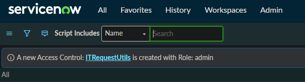

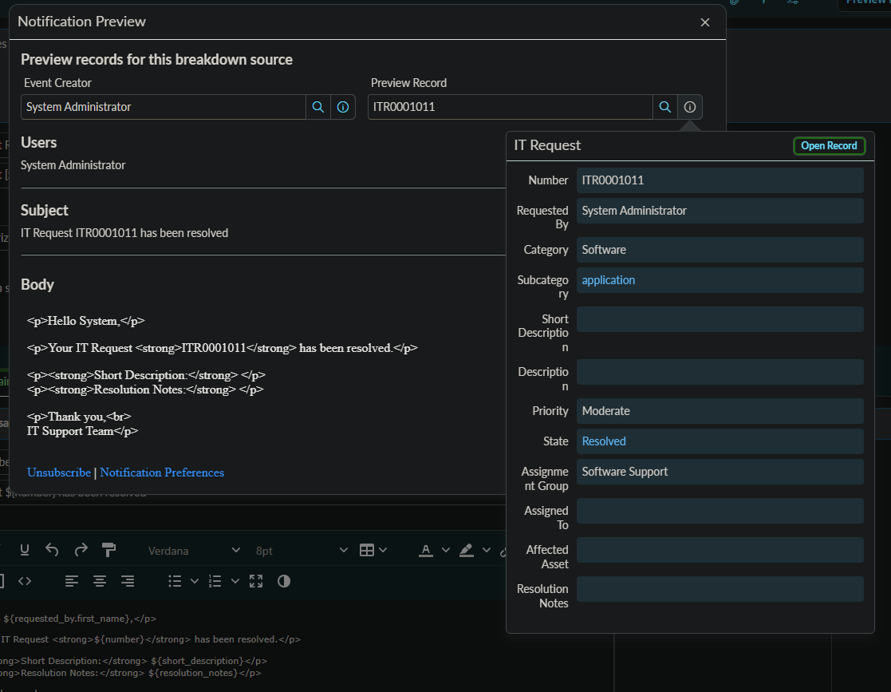

### Automation & Testing

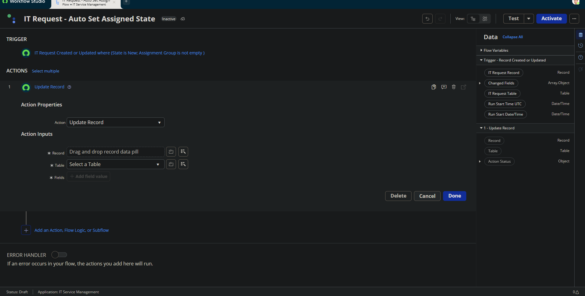

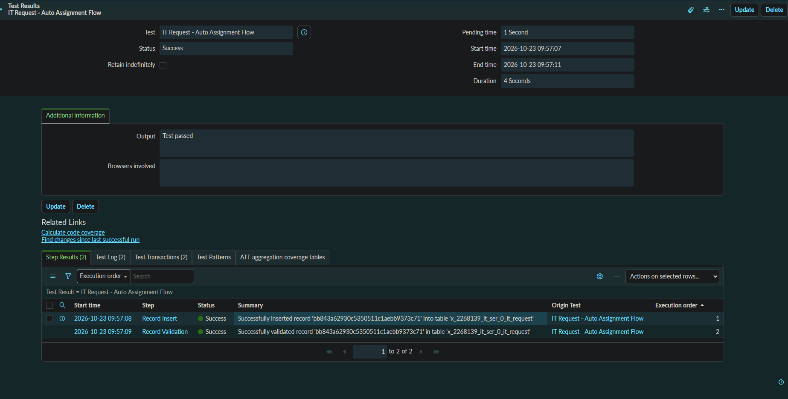

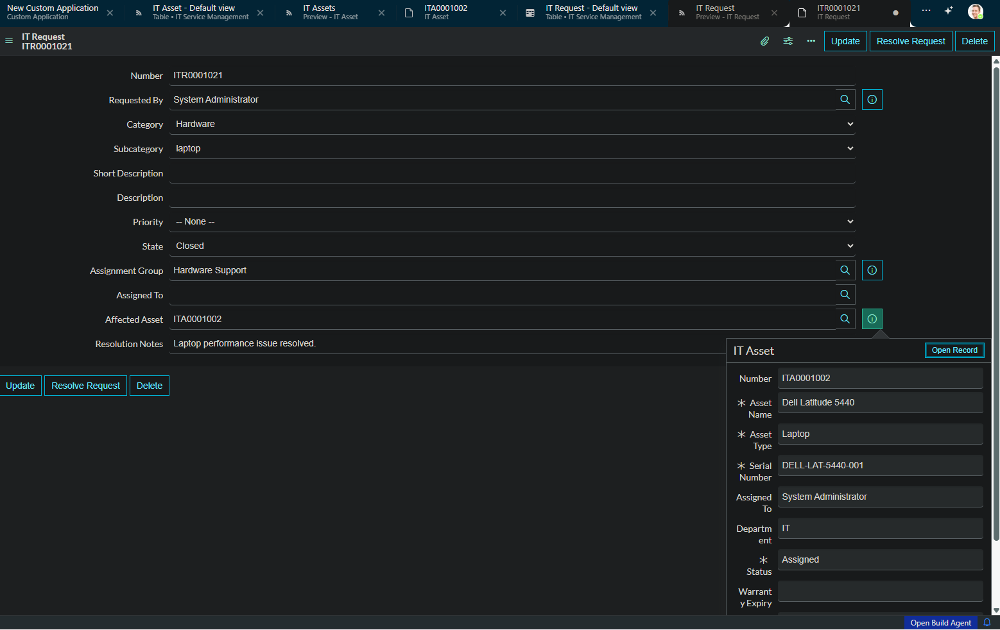

---

## 🧪 Testing

The application was validated through functional testing of:

* IT Request creation
* Requested By auto-fill
* Dynamic subcategory behavior
* Assignment Group routing
* GlideAjax communication
* Resolve Request action
* Close Request action
* Resolution notification
* Flow Designer automation
* ACL configuration
* ATF automated testing

---

## 🛠️ Technologies

* ServiceNow
* ServiceNow Personal Developer Instance (PDI)
* JavaScript
* GlideRecord
* GlideAjax
* Script Includes
* Business Rules
* Client Scripts
* UI Policies
* UI Actions
* Flow Designer
* ACLs
* Notifications
* Automated Test Framework (ATF)

---

## 📁 Documentation

Detailed technical documentation is available in the [`documentation`](documentation/) folder.

It covers:

* Application architecture
* Data model
* Client-side automation
* Server-side automation
* GlideAjax
* UI Actions
* Security
* Notifications
* Flow Designer
* ATF
* Testing
* Deployment considerations

---

## 🚀 Future Enhancements

Potential improvements include:

* Automatic Assigned To selection
* SLA management
* IT asset lifecycle automation
* ServiceNow dashboards
* Expanded ATF test coverage
* Enhanced assignment logic based on workload
* Production SMTP/email configuration
* Proper Update Set strategy for deployment

---

## 👨‍💻 Author

**Sreepada Mohana Krishna**

ServiceNow Developer | B.Tech – Information Technology

---

## 📌 Project Status

**Completed — Portfolio Project**

Built using a ServiceNow Personal Developer Instance (PDI).
